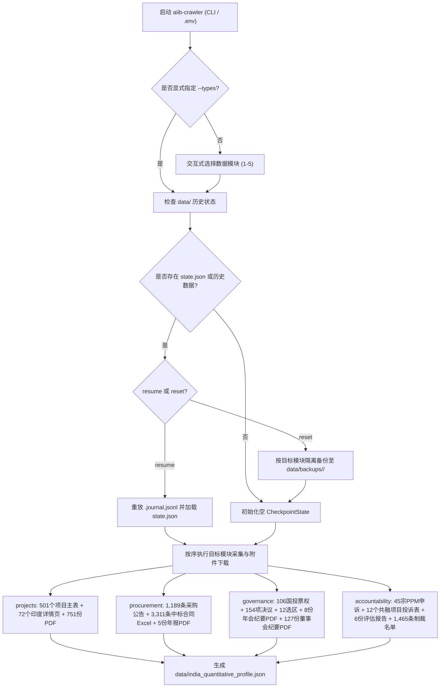

# AIIB Crawler and Analysis (`AIIB_Crawler_And_Analysis`)

亚洲基础设施投资银行（AIIB，亚投行）全量公开数据采集与实证分析仓库。工程架构、拟人化反爬策略（`stealth.py`）、CLI 交互、预写式日志（`.journal.jsonl`）与按模块隔离的断点续传/重置机制（`storage.py`）严格对齐 `X_Crawler` 工程规范。

---

## 模块详细文档索引 (`docs/`)

每个数据模块的数据源地址、采集与解析流程、复现命令、本地输出文件清单及完整字段字典（Codebook）详见 `docs/` 目录：

1. **[01 常规项目模块 (`projects`) 数据采集说明](docs/01_projects.md)**
2. **[02 项目采购与中标合同模块 (`procurement`) 数据采集说明](docs/02_procurement.md)**
3. **[03 治理与投票权模块 (`governance`) 数据采集说明](docs/03_governance.md)**
4. **[04 问责、独立评估与制裁模块 (`accountability`) 数据采集说明](docs/04_accountability.md)**

---

## 核心特性与四维数据集概览

- **四大核心模块全量采集**：
  - `projects`（**投资项目**）：全行 **501 个**常规项目总表 (`all_projects_summary.json`)、**72 个**印度项目子集 (`india_projects_summary.json`)、全部 72 个印度项目网页详情结构化解析 (`india_project_details.json`，含项目编号、环社风险等级 `A/B/C/FI`、概念审批日、融资批准日、审批周期天数 `approval_lag_days`、联合融资伙伴、环境社会适用政策、金融中介转贷标识、印度次国家邦级分布 `indian_states`) 以及 **751 份**项目 PDF 附件（`PSI`、`PD`、`PIMR`、贷款协议等）。
  - `procurement`（**采购与中标合同**）：官方汇总发布的 **《2016–2025 全量中标合同主表》** Excel（`List-of-Contract-Awards_2016-2025.xlsx`，含 **3,311 条**已签署合同，其中印度项目合同 **1,110 条**、印度国籍企业中标 **1,116 条**）、采购动态列表页（`ppo-data-all.js`，共 **1,189 条**采购计划、招标公告与近期中标通知，其中涉印记录 **272 条**），以及 **2021–2025 年共 5 份《年度运营采购报告》PDF**。
  - `governance`（**治理与投票权**）：全部 **106 个**正式成员国与 **4 个**准成员认缴股本与投票权表 (`members_voting_power.json`)、**105 条**各国理事与副理事名单 (`board_of_governors.json`)、**154 项**理事会正式决议全文 (`governors_resolutions.json`)、历届理事会年会 **8 份正式纪要 PDF 原件**及涉印段落提取 (`india_governor_proceedings_mentions.json`)、董事会 **12 个选区**构成表 (`board_of_directors_constituencies.json`，其中第 10 选区为全行唯一由印度单一主权国家独占的选区) 以及 **127 份董事会历次会议纪要 PDF 原件** (`board_of_directors_meeting_minutes.json`)。
  - `accountability`（**申诉、独立评估与制裁名单**）：受影响民众机制 (`PPM`) 全部 **45 宗**申诉案件 (`ppm_submissions_all.json`，其中印度 **14 宗**，占全行 `31.11%`，居全行第一)、联合融资伙伴问责机制统计表 (`ppm_cofinancier_iam_cases.json`，共 **12 个**联合融资项目、**80 宗**投诉，含 2 个印度项目)、独立评估局 (`CEIU`) **6 份**项目学习评估报告与 **20 期**实践者对话 (`ceiu_evaluation_reports.json`，含印度古吉拉特邦农村公路项目评估报告 PDF 原件) 以及 **1,465 条**违规企业制裁黑名单 (`debarment_list.json`，含 **51 家**印度实体)。
- **增量日志与按模块隔离的断点续传/重置**：
  - 采用 `.journal.jsonl` 预写式日志 + 同目录临时文件 `fsync` + `os.replace` 原子写入 `state.json`。
  - 支持任意时刻 `Ctrl+C` 安全中断并在下次通过 `--mode resume` 无损续传（包括未下载完的 PDF 附件）。
  - 指定 `--types <module> --mode reset` 时，仅将该模块的旧数据备份移入 `data/backups/<timestamp>/`，不会影响其他已采集模块的数据。

---

## 工作流程



---

## 快速开始

### 1. 安装依赖

确保已安装 [`uv`](https://docs.astral.sh/uv/)，在项目根目录执行：

```bash
uv sync
```

### 2. 配置环境变量（可选）

```bash
cp .env.example .env
```

| 环境变量 | 默认值 | 说明 |
| :--- | :--- | :--- |
| `CRAWL_TYPES` | 空（交互询问） | 要抓取的模块，逗号分隔：`projects,procurement,governance,accountability` 或 `all` |
| `RESUME_MODE` | 空（交互询问） | 断点处理模式：`resume`（继续上次进度）或 `reset`（备份目标模块旧数据并重新开始） |
| `COUNTRY_FILTER` | `ALL` | 项目详情页抓取范围：`ALL`（先抓印度再抓全行）或 `India`（仅抓印度详情页，主表仍保留全行 501 个项目） |
| `DOWNLOAD_PDFS` | `india` | PDF 下载策略：`none`（仅 JSON + 中标合同 Excel）、`india`（下载印度项目及治理/采购/评估核心 PDF）、`all`（全量 PDF） |
| `MAX_DETAIL_PAGES` | `0` | 最大抓取的项目详情页数（`0` 表示不限制） |
| `SINCE` / `UNTIL` | 空 | 年份或日期上下界过滤（如 `2016`、`2026-12-31`） |
| `TIMEZONE` | `UTC` | 时区设置（支持 `UTC`、`+08:00`、`Asia/Shanghai`） |
| `DATA_DIR` | `./data` | 数据输出目录 |

### 3. 各模块常用复现命令

```bash
# 1. 投资项目模块：采集全行项目主表 + 印度 72 个项目详情页 + 下载 751 份印度项目 PDF
uv run python main.py --types projects --country India --download-pdfs india --mode resume

# 2. 采购与中标模块：采集采购动态列表 + 下载 2016-2025 中标合同主表 Excel + 5 份年度采购报告 PDF
uv run python main.py --types procurement --download-pdfs india --mode resume

# 3. 治理与投票权模块：采集投票权/理事会/董事会数据 + 下载 8 份理事会年会纪要 PDF + 127 份董事会纪要 PDF
uv run python main.py --types governance --download-pdfs india --mode resume

# 4. 申诉与制裁模块：采集 PPM 申诉/共融 IAM 统计/CEIU 评估/制裁名单 + 下载涉印评估与撤回项目 PDF
uv run python main.py --types accountability --download-pdfs india --mode resume
```

---

## 本地输出目录结构 (`data/`)

> 注：`data/` 目录已在 `.gitignore` 中忽略，不会随代码推送到远端仓库。

```text
data/
├── state.json                                  # 断点续传状态 (seen_ids, completed_tabs, updated_at)
├── india_quantitative_profile.json             # 自动汇总的印度参与度与多维量化指标画像
├── projects.json                               # 项目详情页主汇总表
├── procurement.json                            # 采购与合同授予主汇总表
├── governance.json                             # 治理结构主汇总表
├── accountability.json                         # 问责与评估主汇总表
├── projects/
│   ├── all_projects_summary.json               # 全行 501 个项目列表主表
│   ├── india_projects_summary.json             # 印度 72 个项目列表子集
│   ├── project_details_all.json                # 已抓取的项目详情页结构化数据
│   ├── india_project_details.json              # 印度 72 个项目详情页深度解析（含 751 条文档链接）
│   └── pdfs/                                   # 按项目编号归档的印度项目 PDF 文档 (751 份)
├── procurement/
│   ├── procurement_overview_files.json         # 中标合同全表 Excel 与 5 份年度采购报告索引
│   ├── procurement_all_records.json            # 全行 1,189 条采购计划、招标公告与合同授予通知
│   ├── contract_awards_notices.json            # 292 条合同授予通知子集
│   ├── india_procurement_records.json          # 272 条涉印项目或印度承包商采购记录
│   ├── india_contract_awards.json              # 42 条涉印近期合同授予通知子集
│   └── files/
│       ├── List-of-Contract-Awards_2016-2025.xlsx  # 官方 2016–2025 全量中标合同主表 (3,311 条)
│       └── 2021~2025-AIIB-Annual-Operational-Procurement-Report.pdf (共 5 份)
├── governance/
│   ├── members_voting_power.json               # 106 个正式成员国及 4 个准成员股本与投票权表
│   ├── board_of_governors.json                 # 105 条各国理事与副理事名单
│   ├── governors_resolutions.json              # 154 项历年理事会正式决议及全文
│   ├── governors_annual_proceedings.json       # 8 份历届理事会年会纪要索引
│   ├── india_governor_proceedings_mentions.json# 从 8 份年会纪要 PDF 中提取的 111 处涉印段落
│   ├── board_of_directors_constituencies.json  # 董事会 12 个选区构成表（第 10 选区为印度独占）
│   ├── board_of_directors_meeting_minutes.json # 127 份历次董事会会议纪要列表与本地路径
│   └── pdfs/
│       ├── annual_proceedings/                 # 历届理事会年会纪要 PDF 原件 (8 份)
│       └── board_minutes/                      # 董事会历次会议纪要 PDF 原件 (127 份)
└── accountability/
    ├── ppm_submissions_all.json                # PPM 全部 45 宗申诉案件详情
    ├── india_ppm_submissions.json              # 印度 14 宗 PPM 申诉案件子集
    ├── ppm_cofinancier_iam_cases.json          # 12 个联合融资项目在伙伴银行的 80 宗投诉统计表
    ├── ceiu_evaluation_reports.json            # CEIU 6 份项目学习评估报告 (PLR) 与 20 期实践者对话
    ├── debarment_list.json                     # 1,465 条违规企业制裁黑名单（含 51 家印度实体）
    └── pdfs/                                   # 印度古吉拉特邦公路评估报告及大阿尼卡特运河 PSI PDF
```

---

## 代码质量与单元测试

```bash
# 代码规范与格式化检查
uv run ruff check .
uv run ruff format --check .

# 运行单元测试
uv run pytest -v
```
