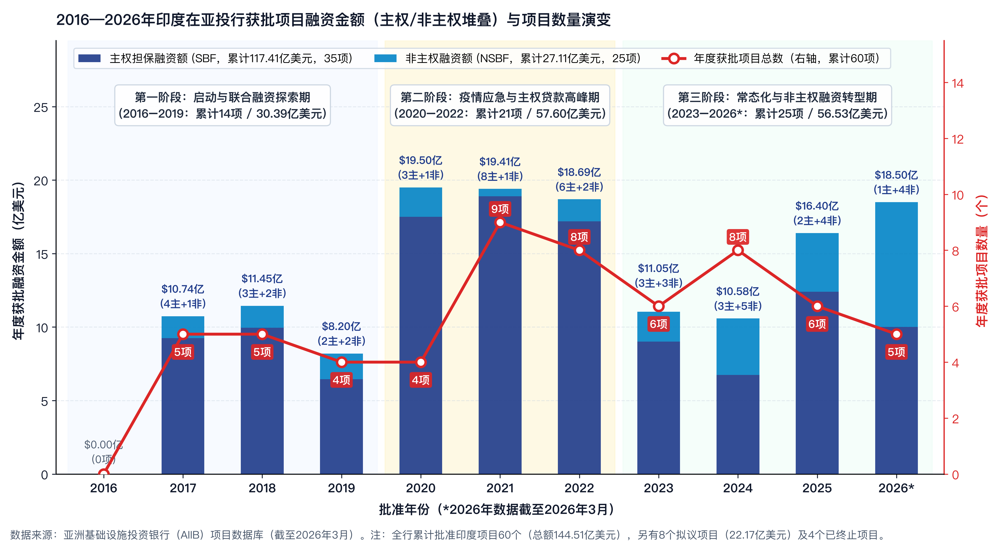
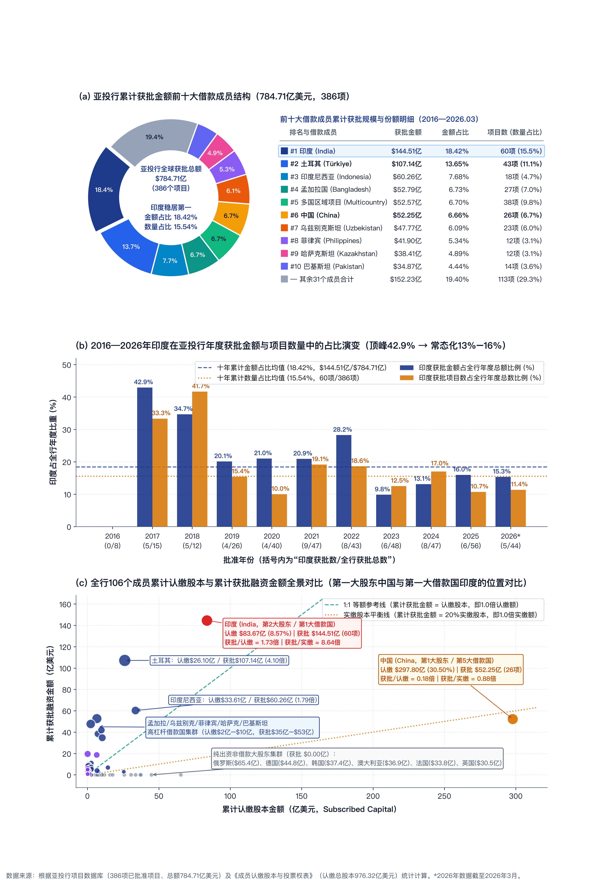
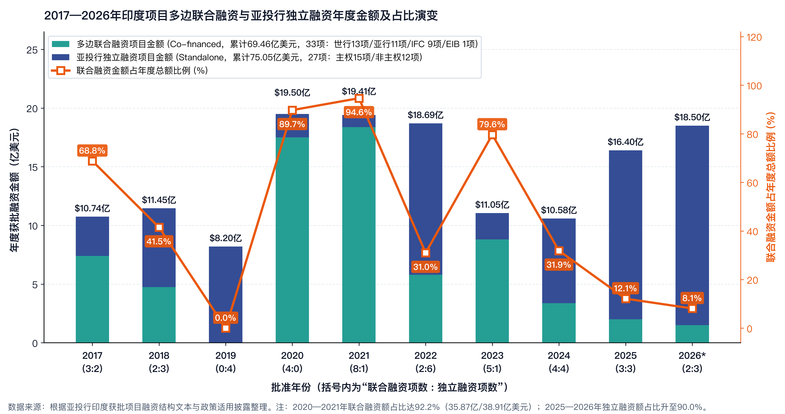
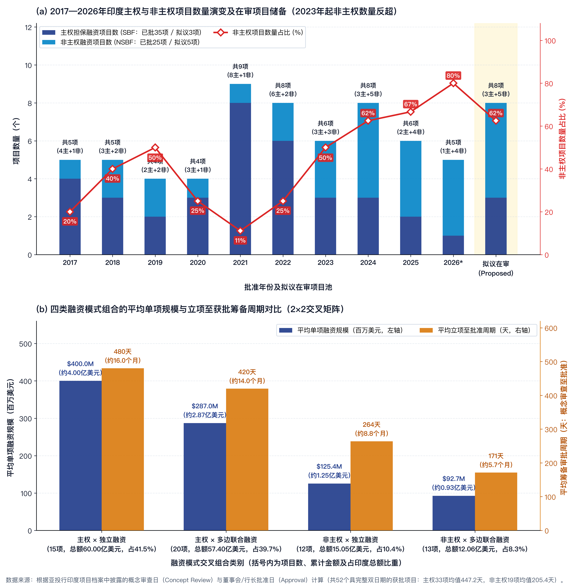
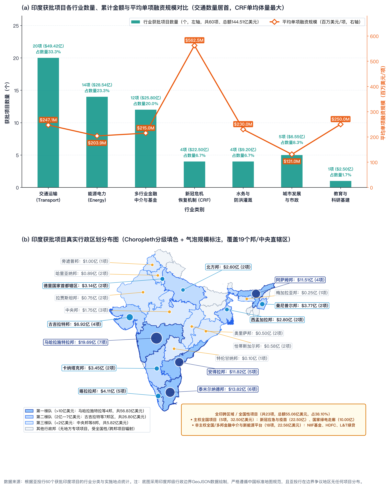
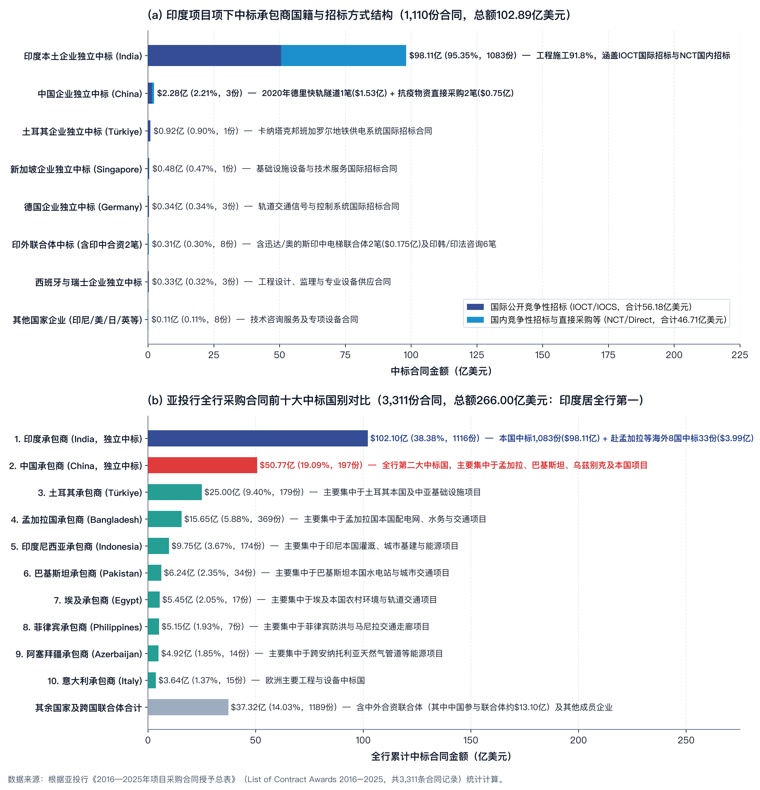
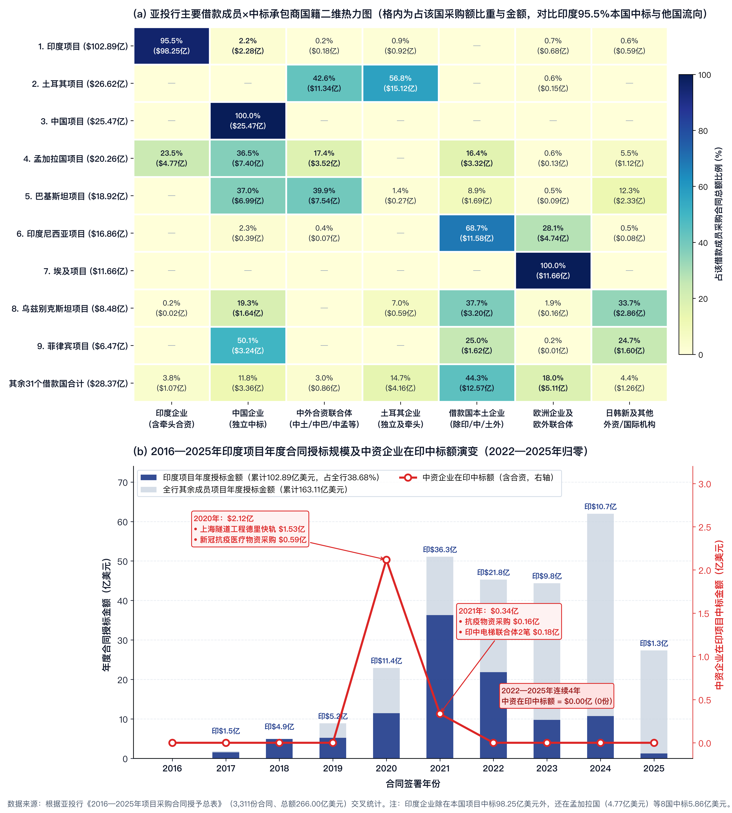

# 第二章 从“项目与采购”看印度的实质参与

印度在亚洲基础设施投资银行（以下简称“亚投行”）中的参与情况，可以通过项目审批数据与项目采购合同数据进行实证检验。自2016年1月亚投行正式开业运营至2026年3月，印度在双边外交层面多次缺席“一带一路”国际合作高峰论坛，并在2020年边境冲突后收紧了对华经贸与投资限制，但印度在亚投行业务端的贷款申请、项目执行与工程采购从未中断。[^1]基于亚投行公开披露的全量501条项目记录及《2016—2025年项目采购合同授予总表》（List of Contract Awards）收录的3,311条合同记录，本章从获批项目规模与全球占比、融资模式演变、行业分布结构、国内地理空间分布以及项目采购合同与中标方国籍分布五个维度，对印度在亚投行的实质参与进行定量分析。[^1]

## 2.1 项目规模与全局地位：印度获批数量、金额及占全行比重演变

### 2.1.1 全量项目池状态与前十大借款成员横向对比

截至2026年3月，亚投行全行数据库共收录501个项目记录，其中已批准（Approved）项目386个，累计获批融资金额784.71亿美元；拟议在审（Proposed）项目99个；已终止或取消（Terminated/Cancelled）项目15个；暂缓（On Hold）项目1个。在上述全量项目池中，涉及印度的项目记录共计72个，按项目状态划分为三类：其一，已批准项目60个，累计获批融资金额144.5125亿美元（约合144.51亿美元）；其二，拟议在审项目8个，拟申请融资金额合计22.1664亿美元（约合22.17亿美元）；其三，已终止或取消项目4个，涉及原拟议融资金额1.955亿美元。[^3]已终止的4个项目分别为：首都辖区空气质量管理项目（项目编号P000390，主权贷款，原拟议金额5亿美元）、印孚瑟斯太阳能在印一期项目（P000370，非主权融资，5,000万美元）、塔塔待建绿地可再生能源项目（P000462，非主权融资，7,550万美元）以及混合可再生能源基础设施项目（P000516，非主权融资，7,000万美元）。

在全行已获批的386个项目中，印度以60个获批项目和144.51亿美元获批总额，在所有借款成员中同时位居项目数量第一位和融资金额第一位。从全球占比看，印度获批项目数量占全行获批项目总数的15.54%（60/386），获批融资金额占全行获批总额的18.42%（144.5125亿/784.71亿美元）。排名第二位的土耳其累计获批43个项目、总额107.14亿美元（占全行总额的13.65%）；排名第三位的印度尼西亚累计获批18个项目、总额60.26亿美元（占7.68%）；排名第四位的孟加拉国累计获批27个项目、总额52.79亿美元（占6.73%）；跨国及多国区域项目（Multicountry）累计获批38个、总额52.57亿美元（占6.70%）；排名第五位的单一借款成员中国累计获批26个项目、总额52.25亿美元（占6.66%）。[^4]印度的累计获批融资金额是第二名土耳其的1.35倍、第三名印度尼西亚的2.40倍、第五名中国的2.77倍。从单项平均规模看，印度60个获批项目的平均单项融资额为2.4085亿美元，高于全行386个获批项目的平均单项融资额（2.0329亿美元）。

进一步将各成员在亚投行的“累计认缴股本金额（Subscribed Capital）”与“累计获批融资金额（Approved Financing）”置于同一二维坐标系中进行跨国对比（见表2-1及图2-2c），可以观察到亚投行全行106个正式成员呈现出四类截然不同的结构分布：第一类是以印度为代表的“高认缴股本、超高贷款回报”成员。印度累计认缴股本83.673亿美元（占全行总认缴股本976.322亿美元的8.57%，居全行第二位），按《亚投行协定》20%实缴比例折算，印度实际缴纳股本金（Paid-in Capital）为16.7346亿美元；而印度累计从亚投行获得的批准融资金额高达144.5125亿美元，其“累计获批融资金额/认缴股本金额”之比达到1.73倍，“累计获批融资金额/实缴股本金额”之比高达8.64倍。[^5]第二类是以中国为代表的“第一大出资股东、适度借款”成员。中国累计认缴股本297.804亿美元（占全行30.50%，居第一位），实际缴纳股本金59.5608亿美元，但累计获批融资金额仅为52.25亿美元（占全行6.66%，居第五位），其“获批金额/认缴股本”之比仅为0.18倍，“获批金额/实缴股本”之比为0.88倍，即中国在亚投行十年累计获得的贷款总额尚不及其实缴现金股本。第三类是以土耳其（认缴26.10亿美元、获批107.14亿美元，认缴撬动比4.10倍）、印度尼西亚（认缴33.61亿美元、获批60.26亿美元，1.79倍）、孟加拉国（认缴6.61亿美元、获批52.79亿美元，7.99倍）、乌兹别克斯坦（认缴2.20亿美元、获批47.77亿美元，21.74倍）、菲律宾（4.28倍）、哈萨克斯坦（5.27倍）和巴基斯坦（3.37倍）为代表的“中小股本、高倍杠杆借款国”集群。第四类是以俄罗斯（认缴65.36亿美元）、德国（44.84亿美元）、韩国（37.39亿美元）、澳大利亚（36.91亿美元）、法国（33.76亿美元）及英国（30.55亿美元）等为代表的“纯出资非借款股东”（累计获批金额均为0美元）。横向对比表明，印度是亚投行内唯一同时兼具“第二大股东体量”与“超额净借款收益（获批额超出认缴股本60.84亿美元）”的成员国。

**表 2-1 亚投行累计获批融资金额前十大借款成员及认缴股本撬动倍数对比表（2016—2026年3月）**

| 排名 | 借款成员/区域类别 | 认缴股本（亿美元） | 获批项目数（个） | 获批融资金额（亿美元） | 占全行获批额比重 | 获批额 / 认缴股本倍数 | 获批额 / 实缴股本倍数 |
| --- | --- | --- | --- | --- | --- | --- | --- |
| 1 | 印度 (India) | 83.67 | 60 | 144.51 | 18.42% | 1.73倍 | 8.64倍 |
| 2 | 土耳其 (Türkiye) | 26.10 | 43 | 107.14 | 13.65% | 4.10倍 | 20.52倍 |
| 3 | 印度尼西亚 (Indonesia) | 33.61 | 18 | 60.26 | 7.68% | 1.79倍 | 8.97倍 |
| 4 | 孟加拉国 (Bangladesh) | 6.61 | 27 | 52.79 | 6.73% | 7.99倍 | 39.96倍 |
| — | 多国区域项目 (Multicountry) | — | 38 | 52.57 | 6.70% | — | — |
| 5 | 中国 (China) | 297.80 | 26 | 52.25 | 6.66% | 0.18倍 | 0.88倍 |
| 6 | 乌兹别克斯坦 (Uzbekistan) | 2.20 | 23 | 47.77 | 6.09% | 21.74倍 | 108.68倍 |
| 7 | 菲律宾 (Philippines) | 9.79 | 12 | 41.90 | 5.34% | 4.28倍 | 21.40倍 |
| 8 | 哈萨克斯坦 (Kazakhstan) | 7.29 | 12 | 38.41 | 4.89% | 5.27倍 | 26.33倍 |
| 9 | 巴基斯坦 (Pakistan) | 10.34 | 14 | 34.87 | 4.44% | 3.37倍 | 16.86倍 |
| — | 其余成员合计 (含96个成员) | 498.91 | 113 | 152.23 | 19.40% | 0.31倍 | 1.53倍 |
| 合计 | 全行总计 (106个成员) | 976.32 | 386 | 784.71 | 100.00% | 0.80倍 | 4.02倍 |

*数据来源：根据亚投行项目数据库（386项已批准项目）及《成员认缴股本与投票权表》（认缴总股本976.32亿美元，实缴股本按法定20%折算）统计计算。*

### 2.1.2 2016—2026年印度获批项目的三阶段历时性演变

从2016年至2026年3月的年度序列看，印度在亚投行的项目获批轨迹与历年占全行比重呈现出明显的阶段性特征（见图2-1、图2-2及表2-2）：

第一阶段为启动与联合融资探索期（2016—2019年）。2016年亚投行开业首年共批准8个项目（总额16.94亿美元），当年印度尚无项目完成审批（2016年12月提交概念审查的安得拉邦全天候供电项目于2017年5月正式获批）。2017年，印度全年获批5个项目、融资金额10.74亿美元，占当年全行获批项目总数（15项）的33.33%，占当年全行获批总额（25.03亿美元）的42.91%。[^6]2018年，印度再次获批5个项目、融资金额11.45亿美元，占全行当年获批项目总数（12项）的41.67%和获批总额（33.03亿美元）的34.66%。2019年，随着亚投行借款成员范围扩大（全行获批数增至26项、总额40.82亿美元），印度获批4个项目、融资金额8.20亿美元，占全行年度总额的20.09%。2016—2019年四年间，印度累计获批14个项目（主权融资9项、非主权融资5项），累计获批金额30.39亿美元，占同期全行获批总额（115.82亿美元）的26.24%。

第二阶段为疫情应急与主权贷款高峰期（2020—2022年）。2020年6月加勒万河谷边境冲突发生后，中印双边政治关系出现紧张，但印度财政部在亚投行的主权贷款提款与项目申报不仅没有收缩，反而在2020—2022年达到历史峰值。2020年，印度获批4个项目、融资金额跃升至19.50亿美元（含两笔合计12.50亿美元的新冠危机恢复机制主权贷款及5亿美元德里—密拉特区域快速轨道交通主权贷款），占全行年度获批总额（92.96亿美元）的20.98%。[^7]2021年，印度获批项目数量达到单年最高的9个（主权8项、非主权1项），融资金额19.41亿美元（含金奈地铁二期、孟买地铁5号线及5亿美元新冠疫苗采购贷款），占全行年度总额（92.90亿美元）的20.89%。2022年，印度获批8个项目（主权6项、非主权2项），融资金额18.69亿美元，占全行年度获批总额（66.15亿美元）的比重回升至28.25%。2020—2022年三年间，印度累计获批21个项目（其中主权项目多达17个），累计获批金额达57.60亿美元，年均获批额19.20亿美元，占印度十年累计获批总额的39.86%。

第三阶段为常态化与非主权融资转型期（2023—2026年3月）。2023年起，随着亚投行全球业务规模扩大至每年80亿至120亿美元区间，以及印度联邦政府财政赤字整固政策对新增外部主权债务节奏的调控，印度在亚投行的年度获批金额占比稳定在10%—16%区间，同时非主权私营部门项目数量首次超过主权项目。2023年，印度获批6个项目（主权3项、非主权3项）、总额11.05亿美元（占全行9.82%）；2024年获批8个项目（主权3项、非主权5项）、总额10.58亿美元（占全行13.08%）；2025年获批6个项目（主权2项、非主权4项）、总额16.40亿美元（占全行15.96%）；2026年1—3月已获批5个项目（主权1项、非主权4项）、总额18.50亿美元（占全行15.32%）。2023年至2026年3月，印度累计获批25个项目、融资金额56.53亿美元。

*图 2-1 2016—2026年印度在亚投行获批项目融资金额（主权/非主权堆叠）与项目数量演变*

*图 2-2 亚投行前十大借款成员份额（a）、印度历年占比变化（b）及全成员认缴股本—获批金额对比散点图（c）*

**表 2-2 2016—2026年印度在亚投行获批项目数量、金额及占全行年度比重明细表**

| 年份 | 印度获批数（主权/非主权） | 全行获批总数 | 印度数量占比 | 印度获批金额（亿美元） | 全行获批总额（亿美元） | 印度金额占比 |
| --- | --- | --- | --- | --- | --- | --- |
| 2016 | 0 (0 / 0) | 8 | 0.00% | 0.00 | 16.94 | 0.00% |
| 2017 | 5 (4 / 1) | 15 | 33.33% | 10.74 | 25.03 | 42.91% |
| 2018 | 5 (3 / 2) | 12 | 41.67% | 11.45 | 33.03 | 34.66% |
| 2019 | 4 (2 / 2) | 26 | 15.38% | 8.20 | 40.82 | 20.09% |
| 2020 | 4 (3 / 1) | 40 | 10.00% | 19.50 | 92.96 | 20.98% |
| 2021 | 9 (8 / 1) | 47 | 19.15% | 19.41 | 92.90 | 20.89% |
| 2022 | 8 (6 / 2) | 43 | 18.60% | 18.69 | 66.15 | 28.25% |
| 2023 | 6 (3 / 3) | 48 | 12.50% | 11.05 | 112.47 | 9.82% |
| 2024 | 8 (3 / 5) | 47 | 17.02% | 10.58 | 80.91 | 13.08% |
| 2025 | 6 (2 / 4) | 56 | 10.71% | 16.40 | 102.75 | 15.96% |
| 2026* | 5 (1 / 4) | 44 | 11.36% | 18.50 | 120.74 | 15.32% |
| 累计 | 60 (35 / 25) | 386 | 15.54% | 144.51 | 784.71 | 18.42% |

*数据来源：根据亚投行项目数据库整理计算。*注：2026年数据截至2026年3月。*

## 2.2 融资模式演变：多边联合融资与亚投行独立融资、主权与非主权结构

### 2.2.1 多边联合融资（WB/ADB/IFC）与亚投行独立融资的比重交替

在60个获批的印度项目中，按是否引入其他多边开发银行作为联合融资方（Co-financing）划分，多边联合融资项目共计33个（占印度获批项目总数的55.00%），累计获批金额69.4592亿美元（约合69.46亿美元，占印度获批总额的48.06%）；亚投行独立融资（Standalone）项目共计27个（占项目总数的45.00%），累计获批金额75.0533亿美元（约合75.05亿美元，占印度获批总额的51.94%）。按具体联合融资伙伴分类，33个多边联合融资项目的合作机构构成如下：

（1）与世界银行（WB，含国际复兴开发银行IBRD与国际开发协会IDA）联合融资项目共13个（含12个双边联合融资及1个与世行、亚行三方联合融资的西孟加拉邦达摩达尔河谷灌溉项目P000230），亚投行出资总额33.8917亿美元，全部为主权担保贷款。代表性项目包括安得拉邦全天候供电项目（P000009，1.60亿美元）、高等教育与科研发展项目（P000090，2.50亿美元）、新冠应急响应与医疗系统准备项目（P000380，5.00亿美元）及哈里亚纳邦轨道交通走廊项目（P000515，1.28亿美元）。[^8]

（2）与亚洲开发银行（ADB）联合融资项目共11个（含10个双边联合融资及上述1个三方联合融资），亚投行出资总额26.0125亿美元，亦全部为主权担保贷款。代表性项目包括印度输电系统强化项目（P000026，1.00亿美元）、德里—密拉特区域快速轨道交通项目（P000352，5.00亿美元）、新冠积极响应与支出支持贷款（P000413，7.50亿美元）以及新冠疫苗采购项目（P000525，5.00亿美元）。[^9]

（3）与世界银行集团下属国际金融公司（IFC）联合融资项目共9个，亚投行出资总额9.5550亿美元，全部为非主权私营部门融资（涵盖可再生能源电站、绿色保障性住房信贷、医疗健康产业基金及电力传输基础设施投资信托等）。（4）与欧洲投资银行（EIB）双边联合融资项目1个，即浦那地铁二期工程（P000511，主权贷款1.50亿美元）。此外，孟买城市交通三期（P000062）等项目在后续推进中也与新开发银行（NDB）等机构的平行融资规划形成互补。

从时间序列上看（见图2-3），印度项目的融资模式经历了“联合融资主导—疫情期高度依赖联合融资—近期向亚投行独立融资转换”的演变过程。在2020—2021年中印边境摩擦及新冠疫情暴发期间，印度获批的13个项目中有12个采用与世界银行、亚开行或国际金融公司联合融资的模式，两年间联合融资项目金额高达35.87亿美元，占同期印度获批总额（38.91亿美元）的92.19%。在联合融资模式下，多数主权项目直接适用世行或亚开行的环境社会政策、采购规则及独立问责机制（如亚开行问责机制ADB AM），有效降低了项目在敏感政治周期内的双边合规审查摩擦。[^10]而在2022年及2024—2026年，随着亚投行自身业务团队与印度各级执行机构（如马哈拉施特拉邦地铁公司、金奈地铁公司、国家投资与基础设施基金NIIF等）建立起直接合作规程，亚投行独立融资比重显著上升：2025年至2026年3月获批的11个印度项目中，有6个为亚投行独立融资，独立融资金额达31.41亿美元，占同期印度获批总额（34.90亿美元）的90.00%。

*图 2-3 2017—2026年印度项目多边联合融资与亚投行独立融资年度金额及占比演变*

### 2.2.2 主权融资（SBF）与非主权融资（NSBF）转型及筹备审批周期对比

按融资信用主体划分，印度60个获批项目中包含主权担保融资（Sovereign-backed Financing, SBF）35个，累计融资金额117.4075亿美元（占印度获批总额的81.24%），平均单项规模为3.3545亿美元；非主权融资（Nonsovereign-backed Financing, NSBF）25个，累计融资金额27.1050亿美元（占印度获批总额的18.76%），平均单项规模为1.0842亿美元。对比历史阶段可见：2017—2022年期间，印度获批的35个项目中有26个为主权项目（占74.29%）、仅9个为非主权项目（占25.71%）；而2023年至2026年3月期间，印度获批的25个项目中，非主权项目达到16个（占64.00%），主权项目降至9个（占36.00%）。此外，在目前处于拟议在审（Proposed）状态的8个印度储备项目中，非主权项目占5个（拟融资金额9.50亿美元）、主权项目占3个（拟融资金额12.67亿美元），延续了非主权项目数量占优的格局。

造成2023年后印度非主权项目数量快速上升的制度与效率动因，可通过项目档案中披露的“概念审查日（Concept Review Date）”至“董事会/行长批准日（Approval Date）”的筹备审批周期（Lag Time）数据进行量化解释（见图2-4及表2-3）。在对具备完整双日期记录的52个印度获批项目进行统计后发现：主权融资项目（n=33）从立项概念审查到最终获批的平均周期长达447.2天（约14.9个月，中位数为351天），因为主权贷款须依次履行印度各邦政府申报、印度联邦财政部经济事务局（DEA）前置甄别、多边环评公示、政府间贷款谈判及内阁核准等行政程序；而非主权融资项目（n=19）从概念审查到获批的平均周期仅为205.4天（约6.8个月，中位数为182天），审批耗时不到主权项目的一半。[^11]进一步将“主权/非主权”与“独立/联合融资”进行2×2交叉分组可见：“主权×独立融资”项目的平均单项规模最大（4.0002亿美元），但平均筹备审批周期也最长（480.2天，约16.0个月）；“主权×联合融资”项目平均规模为2.8702亿美元，平均审批周期缩短至419.8天（约14.0个月）；“非主权×独立融资”项目平均规模为1.2542亿美元，平均审批周期为264.0天（约8.8个月）；“非主权×联合融资”项目（主要为与IFC联合投资）平均规模为0.9273亿美元，平均审批周期仅为171.2天（约5.7个月）。

*图 2-4 2017—2026年印度主权与非主权项目数量演变（上）及2×2融资矩阵审批周期对比（下）*

**表 2-3 印度获批项目“主权/非主权 × 独立/联合融资”四维交叉矩阵统计表**

| 融资交叉类别 | 获批项目数 | 数量占比 | 累计获批金额（亿美元） | 金额占比 | 平均单项规模（百万美元） | 平均筹备审批周期（天/月） |
| --- | --- | --- | --- | --- | --- | --- |
| 主权 × 独立融资 (SBF × Standalone) | 15 | 25.00% | 60.00 | 41.52% | 400.02 | 480.2天 (16.0个月) |
| 主权 × 联合融资 (SBF × Co-financed) | 20 | 33.33% | 57.40 | 39.72% | 287.02 | 419.8天 (14.0个月) |
| 非主权 × 独立融资 (NSBF × Standalone) | 12 | 20.00% | 15.05 | 10.41% | 125.42 | 264.0天 (8.8个月) |
| 非主权 × 联合融资 (NSBF × Co-financed) | 13 | 21.67% | 12.06 | 8.34% | 92.73 | 171.2天 (5.7个月) |
| 主权融资小计 (SBF Total) | 35 | 58.33% | 117.41 | 81.24% | 335.45 | 447.2天 (14.9个月) |
| 非主权融资小计 (NSBF Total) | 25 | 41.67% | 27.11 | 18.76% | 108.42 | 205.4天 (6.8个月) |
| 全样本总计 (India Total) | 60 | 100.00% | 144.51 | 100.00% | 240.85 | 358.8天 (12.0个月) |

*数据来源：根据亚投行印度获批项目数据库整理计算。审批周期基于52个具完整概念审查日与批准日的项目样本。*

## 2.3 项目的行业分布：交通与能源核心主导及金融中介渠道扩张

按照亚投行的标准行业分类（Sector Classification），印度60个获批项目分布在7个行业门类中，按获批融资金额由高到低依次为：交通运输（Transport）、能源电力（Energy）、多行业金融中介与基金（Multi-sector）、新冠危机恢复机制（CRF）、水务与防洪灌溉（Water）、城市发展与市政（Urban）以及教育与科研基础设施（Education Infrastructure）。其中，交通运输与能源电力两大传统硬件基础设施行业合计获批34个项目、融资金额77.9625亿美元，占印度获批项目总数的56.67%和获批总金额的53.95%（见表2-4及图2-5a）：

（1）交通运输行业：获批项目20个（占33.33%），累计获批金额49.4214亿美元（占34.20%），平均单项规模2.4711亿美元，20个项目全部为主权担保贷款。在内部结构上，交通运输行业呈现“大都市轨道交通”与“邦级公路网络”并重的格局：其一，城市轨道交通与区域快轨项目共9个，融资金额高达34.5914亿美元（占交通行业总额的69.99%），涵盖班加罗尔地铁R6线（3.35亿美元）、孟买城市交通三期（5.00亿美元）、德里—密拉特区域快速轨道交通（5.00亿美元）、金奈地铁二期两条走廊（合计7.9435亿美元）、孟买地铁4号线及5号线（合计6.4472亿美元）、哈里亚纳邦轨道交通走廊（1.28亿美元）、高知地铁二期（1.2165亿美元）及浦那地铁二期（1.50亿美元）。[^12]其二，干线公路与农村道路连通性项目共11个，融资金额合计14.83亿美元（占交通行业总额的30.01%），覆盖古吉拉特邦农村公路、中央邦农村连通性、安得拉邦公路网络、曼尼普尔邦伊姆帕尔环城公路及阿萨姆邦道路网现代化等工程。

（2）能源电力行业：获批项目14个（占23.33%），累计获批金额28.5411亿美元（占19.75%），平均单项规模2.0387亿美元。能源行业呈现出清晰的“公私分工”二元结构：在电网输配电环节，6个项目全部为主权担保贷款（合计15.2911亿美元，占能源行业的53.58%），集中投向国家绿色能源走廊、高容量跨区域输电网及安得拉邦、阿萨姆邦、西孟加拉邦的配电网改造；在发电电源环节，8个项目全部为非主权私营部门融资（合计13.25亿美元，占能源行业的46.42%），集中投向拉贾斯坦邦、古吉拉特邦等地的私营太阳能光伏电站、风电基地及可再生能源基础设施投资信托（InvIT）。

（3）多行业金融中介与基金（Multi-sector）：获批项目12个（占20.00%），累计获批金额25.80亿美元（占17.85%），平均单项规模2.15亿美元，12个项目全部为非主权融资。该门类主要通过向印度国家级基建母基金（如印度国家投资与基础设施基金NIIF，获批2亿美元）、大型非银行金融公司（如L&T基础设施金融公司、塔塔清洁技术资本公司、阿迪亚比拉金融公司）及住房金融机构（如HDFC经济适用房绿色信贷项目）提供转贷授信、认购绿色债券或股权注资，将亚投行资金批发式注入印度本土中小型可再生能源、绿色建筑与市政公用事业项目。[^13]

（4）新冠危机恢复机制（CRF）及其他民生市政行业：新冠危机恢复机制下共获批4个主权项目、总额22.50亿美元（占15.57%，单均规模达5.625亿美元），包括两笔公共卫生防疫与疫苗采购贷款（合计10.00亿美元）和两笔面向非正规就业群体与小微企业的紧急财政支出支持贷款（合计12.50亿美元）。水务与防洪灌溉行业获批4个主权项目、总额9.20亿美元（占6.37%），包括安得拉邦城市供水与卫生项目（4.00亿美元）、西孟加拉邦灌溉与防洪项目（1.45亿美元）等。城市发展与市政行业获批5个项目（3个主权项目共4.95亿美元、2个非主权项目共1.60亿美元）、总额6.55亿美元（占4.53%）。教育与科研基础设施行业获批1个主权项目、金额2.50亿美元（占1.73%）。

**表 2-4 印度在亚投行获批项目的行业分布及主权/非主权构成明细表**

| 行业门类 | 项目总数 | 数量占比 | 主权项目（数/额） | 非主权项目（数/额） | 行业获批总额（亿美元） | 金额占比 | 单均规模（百万美元） |
| --- | --- | --- | --- | --- | --- | --- | --- |
| 交通运输 (Transport) | 20 | 33.33% | 20项 / $49.42亿 | 0项 / $0.00亿 | 49.42 | 34.20% | 247.11 |
| 能源电力 (Energy) | 14 | 23.33% | 6项 / $15.29亿 | 8项 / $13.25亿 | 28.54 | 19.75% | 203.87 |
| 多行业金融中介 (Multi-sector) | 12 | 20.00% | 0项 / $0.00亿 | 12项 / $25.80亿* | 25.80 | 17.85% | 215.00 |
| 新冠危机恢复 (CRF) | 4 | 6.67% | 4项 / $22.50亿 | 0项 / $0.00亿 | 22.50 | 15.57% | 562.50 |
| 水务与防洪灌溉 (Water) | 4 | 6.67% | 4项 / $9.20亿 | 0项 / $0.00亿 | 9.20 | 6.37% | 230.00 |
| 城市发展与市政 (Urban) | 5 | 8.33% | 3项 / $4.95亿 | 2项 / $1.60亿 | 6.55 | 4.53% | 131.00 |
| 教育与科研基建 (Education) | 1 | 1.67% | 1项 / $2.50亿 | 0项 / $0.00亿 | 2.50 | 1.73% | 250.00 |
| 合计 | 60 | 100.00% | 35项 / $117.41亿 | 25项 / $27.11亿 | 144.51 | 100.00% | 240.85 |

*数据来源：根据亚投行项目数据库整理。*注：官方Sector分类中部分主权担保下的多部门基础设施开发贷款按Multi-sector统计，表中主权/非主权小计以Financing Type字段为准。*

## 2.4 项目的地理分布：印南、印西沿海经济大邦与东北邦的空间集聚

通过对60个获批项目的项目名称、项目摘要及工程实施地点进行空间编码，可将印度亚投行项目划分为两大空间类别：第一类是“全国性或跨区域多邦项目”（共23个项目，累计获批金额55.06亿美元，占印度获批总额的38.10%），包括5个全国性主权项目（总额32.50亿美元，涵盖新冠疫情防控、疫苗采购及国家绿电走廊跨区输电网）和18个全国性或跨邦非主权金融中介与新能源平台项目（总额22.56亿美元）；第二类是“具有明确单一邦或中央直辖区归属的地方落地项目”（共37个项目，累计获批金额89.4525亿美元，占印度获批总额的61.90%），共覆盖印度19个邦及中央直辖区（见图2-5b及表2-5）。

对19个地方邦区的获批金额与项目数量进行统计排序，可以发现亚投行在印度的地方项目呈现出显著的“三级梯度集聚”特征：

（1）第一梯队为获批金额超过10亿美元的4个核心借款大邦（马哈拉施特拉邦、泰米尔纳德邦、安得拉邦、阿萨姆邦）。这4个邦累计获批22个项目、融资金额合计56.8336亿美元，占全部地方落地项目金额（89.4525亿美元）的63.54%，占印度全口径获批总额（144.5125亿美元）的39.33%。其中，印度第一大经济与金融中心马哈拉施特拉邦位居榜首，累计获批7个项目、总额19.69亿美元（涵盖孟买城市交通三期5亿美元、孟买地铁4号线及5号线共6.45亿美元、浦那地铁二期1.50亿美元及马哈拉施特拉邦综合市政与公路项目）；南部制造业强邦泰米尔纳德邦位居第二，累计获批6个项目、总额13.8175亿美元（核心为金奈地铁二期各走廊及邦级输配电网工程）；东南沿海的安得拉邦位居第三，累计获批5个项目、总额11.82亿美元（涵盖2017年首个获批的安得拉邦全天候供电项目、农村道路、城市供水及首府阿马拉瓦蒂综合城市发展项目）；东北部的枢纽邦阿萨姆邦位居第四，累计获批4个项目、总额11.5061亿美元（涵盖阿萨姆邦输配电网现代化、道路网升级、布拉马普特拉河综合防洪与水资源管理以及城市弹性发展项目）。[^14]

（2）第二梯队为获批金额在2亿至7亿美元之间的7个邦及中央直辖区，累计获批融资金额合计26.80亿美元（占地方落地项目金额的29.96%）。依次为：西部沿海工业大邦古吉拉特邦（4项，6.925亿美元，含农村公路、光伏发电及教育设施）、南部喀拉拉邦（5项，4.1065亿美元，含高知地铁二期、灾后重建及固体废弃物管理）、东北部曼尼普尔邦（2项，3.774亿美元，含伊姆帕尔环城公路）、南部科技中心卡纳塔克邦（2项，3.45亿美元，核心为班加罗尔地铁R6线）、德里国家首都辖区（2项，3.14亿美元，核心为德里—密拉特区域快轨）、东部西孟加拉邦（2项，2.80亿美元，含达摩达尔河谷灌溉及配电网工程）以及北部人口大邦北方邦（2项，2.60亿美元，主要为德里—密拉特快轨北方邦段）。

（3）第三梯队为获批金额在2亿美元以下的8个内陆与资源型邦，累计获批融资金额合计5.8233亿美元（占地方落地项目金额的6.51%），依次为：中央邦（3项，1.75亿美元）、旁遮普邦（1项，1.00亿美元）、哈里亚纳邦（2项，0.89亿美元）、拉贾斯坦邦（2项，0.75亿美元）、恰蒂斯加尔邦（2项，0.5833亿美元）、奥里萨邦（2项，0.50亿美元）、梅加拉亚邦（1项，0.25亿美元）以及特伦甘纳邦（1项，0.10亿美元）。

在空间分布上还有两个客观事实值得注意：第一，印度的东北部地区（阿萨姆邦、曼尼普尔邦、梅加拉亚邦）由于地形复杂且长期面临基础设施赤字，此前在获取传统多边机构商业开发资金时较为受限，但在亚投行累计获得了7个项目、15.53亿美元的大额基础设施贷款；第二，亚投行在印度的全部60个获批项目及8个拟议在审项目，均严格位于无领土主权争议的印度行政邦境内，在克什米尔地区（印控查谟和克什米尔、拉达克）以及中印东段边界争议地区（中国藏南地区/印称“阿鲁纳恰尔邦”）没有任何项目立项或资金投放，体现了多边开发银行规避地缘领土争议区域的审慎原则。

*图 2-5 印度获批项目各行业数量与单均规模对比（上）及印度真实行政区划地理分布图（下）*

**表 2-5 印度19个邦/中央直辖区及全国性亚投行获批项目空间分布明细表**

| 梯度分类 | 邦 / 中央直辖区 | 所属地理分区 | 涉及项目数 | 获批金额（亿美元） | 占全印总额比重 | 主要投向领域与代表性工程 |
| --- | --- | --- | --- | --- | --- | --- |
| 第一梯队 | 马哈拉施特拉邦 (Maharashtra) | 印西沿海 | 7 | 19.69 | 13.62% | 孟买城市交通三期、孟买地铁4/5号线、浦那地铁二期 |
| 第一梯队 | 泰米尔纳德邦 (Tamil Nadu) | 印南沿海 | 6 | 13.82 | 9.56% | 金奈地铁二期各走廊、泰米尔纳德邦输变电网改造 |
| 第一梯队 | 安得拉邦 (Andhra Pradesh) | 东南沿海 | 5 | 11.82 | 8.18% | 全天候供电工程、城市安全供水、农村道路与干线网 |
| 第一梯队 | 阿萨姆邦 (Assam) | 东北地区 | 4 | 11.51 | 7.96% | 邦内输配电网升级、二级公路网改造、布拉马普特拉河防洪 |
| 第二梯队 | 古吉拉特邦 (Gujarat) | 印西沿海 | 4 | 6.93 | 4.79% | 首席部长农村道路计划、250MW光伏电站、区域基础设施 |
| 第二梯队 | 喀拉拉邦 (Kerala) | 印南沿海 | 5 | 4.11 | 2.84% | 高知地铁二期、城市固废管理、水灾后韧性重建工程 |
| 第二梯队 | 曼尼普尔邦 (Manipur) | 东北地区 | 2 | 3.77 | 2.61% | 伊姆帕尔环城公路及邦级道路连通性工程 |
| 第二梯队 | 卡纳塔克邦 (Karnataka) | 印南内陆 | 2 | 3.45 | 2.39% | 班加罗尔地铁R6线走廊工程 (P000038) |
| 第二梯队 | 德里国家首都辖区 (Delhi NCT) | 印北核心 | 2 | 3.14 | 2.17% | 德里—密拉特区域快速轨道交通 (RRTS) 走廊首段 |
| 第二梯队 | 西孟加拉邦 (West Bengal) | 印东地区 | 2 | 2.80 | 1.94% | 达摩达尔河谷灌溉与防洪现代化、邦级配电网工程 |
| 第二梯队 | 北方邦 (Uttar Pradesh) | 印北内陆 | 2 | 2.60 | 1.80% | 德里—密拉特区域快速轨道交通北方邦境内标段 |
| 第三梯队 | 中央邦等其余8个地方邦合计 | 中部/西北等 | 15* | 5.82 | 4.03% | 中央邦农村连通道路、哈里亚纳轨道走廊、拉贾斯坦光伏等 |
| 地方小计 | 19个明确地方归属邦区合计 | 地方落地 | 37 | 89.45 | 61.90% | 主权基建项目30项 ($84.91亿) + 地方非主权7项 ($4.55亿) |
| 全国跨区 | 全印范围 / 跨多邦组合项目 | 全国/跨邦 | 23 | 55.06 | 38.10% | 主权全国项目5项 ($32.50亿) + 非主权基金/绿贷18项 ($22.56亿) |
| 总计 | 印度获批项目总计 | 全境合计 | 60 | 144.51 | 100.00% | 主权项目35项 ($117.41亿) + 非主权项目25项 ($27.11亿) |

*数据来源：根据亚投行60个印度获批项目的实施地点整理计算。*注：跨双邦项目（如德里—北方邦快轨）按实际投资分摊计入两地金额，故分邦提及次数之和略大于地方项目总数37项。*

## 2.5 项目采购与中标方分析：中标企业国籍分布、金额结构与合规记录

### 2.5.1 印度项目采购合同的规模、类别与招标方式结构

项目获批后的采购授标与资金流向，是衡量借款国在多边开发银行中实质获益程度的直接指标。根据亚投行官方发布的《2016—2025年项目采购合同授予总表》（List of Contract Awards），全行在2016—2025年十年间共披露了3,311份投资项目项下的采购合同，累计中标合同总金额为266.0028亿美元（约合266.00亿美元）。其中，在印度作为借款成员的项目项下（AIIB Member为India），共授予采购合同1,110份，占全行合同总数的33.52%；累计中标合同金额达102.8943亿美元（约合102.89亿美元），占全行采购合同总金额的38.68%。[^15]这一数据表明，亚投行全行过去十年已实际落地授标的工程、货物与咨询采购合同总额中，有近四成发生在印度项目项下。

对印度项目项下的1,110份采购合同进行多维度结构拆解：

（1）按采购类别（Category）划分：土建工程施工（Works）合同共733份（占合同数的66.04%），中标金额高达94.4308亿美元，占印度项目采购总额的91.77%，主要为地铁隧道盾构、高架桥墩土建、高压变电站建设及道路铺装；货物与设备（Goods）合同共165份（占14.86%），中标金额7.0108亿美元（占6.81%），主要为地铁车辆、信号机电、电力变压器及医疗防疫物资；咨询服务（Consulting Services）合同共160份（占14.41%），中标金额1.3462亿美元（占1.31%），主要为工程设计、施工监理与环境社会监测；非咨询服务（Non-Consulting Services）合同共52份（占4.68%），中标金额0.1065亿美元（占0.10%）。

（2）按招标采购方式（Procurement Method）划分：国际公开竞争性招标（IOCT）共授予102份大型合同（占合同数的9.19%），但中标金额高达55.0855亿美元，占印度项目采购总额的53.54%（平均单份合同金额达5,400.5万美元）；国内竞争性招标（NCT）共授予660份合同（占59.46%），中标金额41.5795亿美元，占采购总额的40.41%（平均单份合同金额630.0万美元）；直接签订合同（Direct Contracting/Selection）共29份，中标金额4.7689亿美元（占4.63%，主要集中于2020—2021年新冠疫情期间的紧急医疗物资采购与国有铁路既有线接口工程）；国际公开竞争性选聘顾问（IOCS）共35份，中标金额1.0972亿美元（占1.07%）；其余询价采购、框架协议及国家选聘顾问等共284份，合计0.3632亿美元（占0.35%）。按亚投行审查方式划分，由亚投行采购专家进行事前审查（Prior Review）的合同共234份、金额66.9918亿美元（占65.11%）；事后抽查（Post Review）合同共876份、金额35.9025亿美元（占34.89%）。[^16]

### 2.5.2 印度项目的中标方国籍分布与中资企业中标实况

针对“亚投行贷款是否主要用于支持中国工程承包商海外拿单”的外部讨论，印度项目项下1,110份合同的中标方国籍（Contractor Nationality）数据提供了客观的实证结论（见图2-6a及表2-6）：

第一，印度本土企业在印度亚投行项目中占据绝对主导地位。在1,110份合同中，由印度本土企业独立中标（国籍标注为India）的合同多达1,083份，占合同总数的97.57%；中标金额高达98.1146亿美元，占印度项目采购总额（102.8943亿美元）的95.35%。如果加上由印度企业作为牵头方或核心成员参与的8份“印外跨国联合体（Joint Venture）”合同（合计0.3111亿美元，占0.30%），印度本土企业实际参与中标的合同共1,091份（占98.29%），涉及金额达98.4257亿美元（占95.66%）。即便在面向全球承包商开放的102份国际公开竞争性招标（IOCT，总额55.0855亿美元）中，印度本土企业也独立拿下了86份合同、金额50.6168亿美元，占国际招标总额的91.89%。

第二，中国企业在印度亚投行项目中的中标份额极低，且自2022年起完全归零。十年间，由中国企业独立中标（国籍标注为China）的印度项目合同仅有3份（占合同总数的0.27%），累计中标金额2.2791亿美元，仅占印度项目采购总额的2.21%。这3份合同全部发生在2020—2021年期间，具体包括：（1）2020年12月，上海隧道工程股份有限公司（Shanghai Tunnel Engineering Co., Ltd.）通过国际公开竞争性招标，中标德里—密拉特区域快速轨道交通项目（P000352）第4标段（新阿肖克纳加尔至萨希巴巴德地下隧道工程，合同编号DM/CN/COR-OF/095），中标金额1.5272亿美元，这是十年间中资建筑企业在印度亚投行项目中获得的唯一一份土建工程施工合同；（2）2020年9月与2021年5月，在新冠应急响应与医疗系统准备项目（P000380）项下，印度执行机构通过直接采购方式向中资医药及供应链企业采购抗疫医疗物资两笔，金额分别为5,909.25万美元和1,610.09万美元。[^17]此外，2021年6月和8月，在德里—密拉特快轨项目（P000352）的车站自动扶梯与电梯设备国际招标中，迅达印度公司与迅达中国公司联合体（Schindler India & Schindler China）、奥的斯印度公司与奥的斯中国公司联合体（Otis Elevator India & Otis China）分别中标1,309.77万美元和440.51万美元（合计1,750.28万美元，占0.17%）。自2020年7月印度财政部修订《通用财务规则》（GFR 2017）第144(xi)条（要求凡与印度接壤国家的投标人参与印度公共采购均须向印度工业和内部贸易促进局DPIIT进行政治与国家安全前置注册）之后，在2022年、2023年、2024年及2025年连续四年间，中资企业在印度亚投行项目中的中标合同数为0份，中标金额为0美元。

第三，除印度本土企业与中国企业外，其余外国承包商在印度项目中合计独立中标16份合同、金额2.1895亿美元（占2.13%），依次为：土耳其企业1份（0.9221亿美元，占0.90%，为班加罗尔地铁供电系统合同）、新加坡企业1份（0.4819亿美元，占0.47%）、德国企业3份（0.3449亿美元，占0.34%）、西班牙企业2份（0.1976亿美元，占0.19%）、瑞士企业1份（0.1298亿美元，占0.13%）、印度尼西亚企业1份（608万美元）、美国企业3份（394万美元）、日本企业1份（96万美元）、日西联合体1份（30万美元）以及英国企业1份（4万美元）。

### 2.5.3 亚投行全行中标国别对比与主要借款成员×中标方国籍热力图分析

若将视野扩展至亚投行全行3,311份采购合同（总额266.0028亿美元）的全球竞争格局（见图2-6b），印度承包商不仅垄断了本国项目采购，而且在全行所有中标国别中同样高居全球第一位：十年间，印度籍承包商在全行独立中标1,116份合同（占全行合同总数的33.71%），累计独立中标金额达102.1040亿美元，占亚投行全球采购授标总额的38.38%；排名全球第二位的中国籍承包商独立中标197份合同（占5.95%），累计独立中标金额50.7669亿美元，占全行总额的19.09%（若计入中外联合体中标，中国企业参与的合同总额约为63.87亿美元，占全行24.01%）。印度承包商在亚投行全球采购中的独立中标金额是中国承包商独立中标金额的2.01倍。排在第三至第十位的中标国别依次为：土耳其（25.00亿美元，占9.40%）、孟加拉国（15.65亿美元，占5.88%）、印度尼西亚（9.75亿美元，占3.67%）、巴基斯坦（6.24亿美元，占2.35%）、埃及（5.45亿美元，占2.05%）、菲律宾（5.15亿美元，占1.93%）、阿塞拜疆（4.92亿美元，占1.85%）以及意大利（3.64亿美元，占1.37%）。

进一步构建“亚投行主要借款成员×主要中标承包商国籍”二维交叉热力图（见图2-7a），可以直观识别印度项目采购流向与其余借款成员的显著差异：其一，印度项目（采购总额102.89亿美元）呈现出高度封闭的“内循环”特征，印度企业（含牵头合资）中标98.25亿美元（占95.5%），中国企业独立中标仅2.28亿美元（占2.2%），印中合资仅0.18亿美元（占0.2%），且如图2-7b所示，2022—2025年连续四年中资企业在印中标额归零；其二，相比之下，在孟加拉国项目（20.26亿美元）、巴基斯坦项目（18.92亿美元）、菲律宾项目（6.47亿美元）及土耳其项目（26.62亿美元）中，中国企业独立中标及中外合资联合体分别占到了53.9%（7.40亿独立+3.52亿合资）、76.9%（6.99亿独立+7.54亿合资）、50.1%（3.24亿独立）和42.6%（11.34亿中土联合体）；其三，热力图第一列清晰显示，印度工程与咨询企业不仅独享了本国95.5%的亚投行采购蛋糕，还跨国拿下了孟加拉国亚投行项目23.5%的合同份额（4.77亿美元，含10份独立中标3.82亿美元及合资0.95亿美元）以及其余成员项目1.07亿美元合同（遍布乌兹别克斯坦、格鲁吉亚、尼泊尔、老挝等8国，海外中标合计5.86亿美元）。

在印度本国项目的1,110份合同中，市场份额亦高度集中于印度大型私营基建财团与国有工程公司。排名第一的印度工程巨头拉森特博洛集团（Larsen & Toubro Limited, L&T）累计中标20份大型合同，中标总额高达13.9834亿美元，单家企业即占印度亚投行项目采购总额的13.59%，承包了孟买地铁4/5号线、金奈地铁二期及德里—密拉特快轨的核心标段；排名第二的阿夫康斯基础设施公司（Afcons Infrastructure Ltd.，沙普尔吉·帕隆吉集团旗下企业）中标4份合同、总额7.0235亿美元（占6.83%）；排名第三的KEC国际及HCC-KEC联合体中标5份合同、总额3.8465亿美元（占3.74%）；排名第四至第七位的依次为ITD Cementation India（2份，2.6084亿美元）、梅加工程基建公司MEIL（7份，2.4635亿美元）、印度铁道部下属印度铁路建设公司IRCON（4份，2.3141亿美元）以及希尔迪赛电气公司Shirdi Sai Electricals（8份，1.8100亿美元）。前十大印度本土承包商集团合计中标金额达37.71亿美元，占印度项目采购总额的36.65%。

*图 2-6 印度项目项下中标承包商国籍与招标方式结构（上）及全行前十大中标国别对比（下）*

*图 2-7 亚投行主要借款成员×中标承包商国籍二维热力图（上）及印度项目年度授标与中资在印中标演变（下）*

**表 2-6 印度亚投行项目采购合同中标方国籍分布与全行中标格局对比表（2016—2025年）**

| 中标方国籍 / 联合体类别 | 印度项目合同数（份） | 印度项目中标额（亿美元） | 占印度项目采购比重 | 全行项目合同数（份） | 全行项目中标额（亿美元） | 占全行采购总额比重 |
| --- | --- | --- | --- | --- | --- | --- |
| 印度企业独立中标 (India) | 1,083 | 98.11 | 95.35% | 1,116 | 102.10 | 38.38% |
| 印外联合体 (含印中合资2笔) | 8 | 0.31 | 0.30% | 18 | 1.74 | 0.65% |
| 中国企业独立中标 (China) | 3 | 2.28 | 2.21% | 197 | 50.77 | 19.09% |
| 土耳其企业独立中标 (Türkiye) | 1 | 0.92 | 0.90% | 179 | 25.00 | 9.40% |
| 新加坡企业独立中标 (Singapore) | 1 | 0.48 | 0.47% | 10 | 0.70 | 0.26% |
| 德国企业独立中标 (Germany) | 3 | 0.34 | 0.34% | 35 | 1.46 | 0.55% |
| 西班牙企业独立中标 (Spain) | 2 | 0.20 | 0.19% | 44 | 2.09 | 0.79% |
| 瑞士企业独立中标 (Switzerland) | 1 | 0.13 | 0.13% | 13 | 0.24 | 0.09% |
| 其他国家及跨国联合体合计 | 8 | 0.11 | 0.11% | 1,699 | 81.90 | 30.79% |
| 合计 | 1,110 | 102.89 | 100.00% | 3,311 | 266.00 | 100.00% |

*数据来源：根据亚投行《2016—2025年项目采购合同授予总表》（共3,311条合同记录）汇总计算。*

### 2.5.4 项目执行中的合规制裁与独立问责申诉记录

由于印度在亚投行获批项目数与工程采购合同数均占全行三分之一以上，印度也是亚投行廉洁合规制裁体系（Sanctions System）与项目受影响人群机制（Project-affected People's Mechanism, PPM）运行最为集中的国家：

一方面，在廉洁合规与取消资格制裁（Debarment）方面，截至2026年3月，亚投行根据《禁止行为政策》（Policy on Prohibited Practices）公开披露的被制裁主体名单共计1,465家企业或个人（包含亚投行直接调查制裁及与其他多边开发银行交叉执行的制裁名单）。其中，注册地址位于印度的被制裁实体与个人共计51个，占全行黑名单总数的3.48%。在亚投行廉洁局（CEIU）独立查处并直接发起制裁的案件中，涉及印度电力与基建项目投标造假的典型案例包括：对古普塔电力基础设施有限公司（Gupta Power Infrastructure Limited）处以自2025年3月起至2028年9月的三年半取消资格制裁，以及对拉杰什·库马尔·帕特罗（Rajesh Kumar Patro）等相关责任人员处以2025年至2029年的禁入制裁。[^18]

另一方面，在环境社会保障与独立问责申诉方面，截至2026年3月，亚投行PPM公开登记簿在全球范围内共收到45起直接申诉案，其中针对印度项目的直接申诉达14起，占全行PPM申诉总量的31.11%（另有6起针对印度联合融资项目的申诉由牵头联合融资方的问责机制即亚开行问责机制ADB AM和欧洲投资银行投诉机制EIB CM受理，合计涉及印度项目的社区申诉共20起）。[^19]这14起亚投行PPM直接受理的印度申诉案集中于征地拆迁补偿、施工震动损害及生计恢复争议，主要涉及金奈地铁二期走廊4（P000301，共触发6批次申诉，其中5起已进入实质性争议解决程序Dispute Resolution）、孟买城市交通三期（P000062，触发2起申诉，分别进入合规审查Compliance Review与争议解决程序）、班加罗尔地铁R6线（P000038，触发3起申诉）以及曼尼普尔邦伊姆帕尔环城公路（P000297，触发3起申诉）。上述数据表明，印度本土非政府组织与受影响社区对亚投行多边环境社会标准及独立申诉渠道的调用频率居全行首位。

综上所述，2016年至2026年3月的全样本项目与采购数据表明：第一，印度以60个获批项目（占全行15.54%）和144.51亿美元获批融资金额（占全行18.42%）稳居亚投行全球第一大借款成员，且在2020年双边关系波动后其获批规模并未萎缩，而是从早期依赖世行、亚开行联合融资逐步转向亚投行独立融资与非主权私营部门融资；第二，印度获批资金高度集中于交通运输（34.20%）、能源电力（19.75%）及多行业金融中介（17.85%），在地理空间上向马哈拉施特拉、泰米尔纳德、安得拉及阿萨姆等19个非争议行政邦区集聚；第三，在项目采购端，印度项目项下102.89亿美元合同中有95.35%由印度本土企业独立中标（中资企业独立中标仅占2.21%且2022—2025年连续四年归零），同时印度承包商还在其他8个亚投行成员国赢得了5.42亿美元海外合同，以102.10亿美元的全球独立中标额位列亚投行第一大中标国。

---
## 参考文献与注释（GB/T 7714-2015）

[^1]: Asian Infrastructure Investment Bank. Projects Database (All 501 Project Records as of March 2026)[EB/OL]. (2026-03-25)[2026-11-08]. https://www.aiib.org/en/projects/list/index.html.
[^2]: Asian Infrastructure Investment Bank. List of Contract Awards (2016–2025 Cumulative Dataset, 3,311 Contract Records)[EB/OL]. (2026-03-01)[2026-11-08]. https://www.aiib.org/en/opportunities/business/project-procurement/list-of-contract-awards.html.
[^3]: Asian Infrastructure Investment Bank. India Sovereign and Nonsovereign Project Portfolio Summary (72 Records: 60 Approved, 8 Proposed, 4 Cancelled)[EB/OL]. (2026-03-25)[2026-11-08]. https://www.aiib.org/en/projects/list/index.html?member=India.
[^4]: 统计口径说明：根据亚投行全行386个已批准项目（Approved）的融资金额汇总计算。排名前十位的借款成员（含多国区域项目类别）合计获批273个项目、融资金额632.48亿美元，占全行获批总额的80.60%。
[^5]: Asian Infrastructure Investment Bank. Members and Prospective Members of the Bank (Total Subscribed Capital USD 97,632.2 Million; India Subscribed Capital USD 8,367.3 Million or 8.5702%, Voting Power 85,152 Votes or 7.4913%)[EB/OL]. (2026-03-25)[2026-11-08]. https://www.aiib.org/en/about-aiib/governance/members-of-bank/index.html.
[^6]: Asian Infrastructure Investment Bank. India: 24x7 Power for All in Andhra Pradesh (Project No. P000009, Approved May 2, 2017, USD 160 Million)[EB/OL]. (2017-05-02)[2026-11-08]. https://www.aiib.org/en/projects/details/2017/approved/India-24x7-Power-for-All.html.
[^7]: Asian Infrastructure Investment Bank. India: COVID-19 Emergency Response and Health Systems Preparedness Project (P000380, USD 500M, Approved May 7, 2020) & COVID-19 Active Response and Expenditure Support (P000413, USD 750M, Approved June 16, 2020)[EB/OL]. [2026-11-08]. https://www.aiib.org/en/projects/list/index.html.
[^8]: Asian Infrastructure Investment Bank. Project Summary: Damodar Valley Command Area Irrigation Modernization Project (P000230, Co-financed with World Bank and Asian Development Bank, USD 145M/150M)[EB/OL]. [2026-11-08]. https://www.aiib.org/en/projects/details/2020/approved/India-West-Bengal-Major-Irrigation-and-Flood-Management-Project.html.
[^9]: Asian Infrastructure Investment Bank. Project Document: Delhi-Meerut Regional Rapid Transit System (RRTS) (P000352, Co-financed with ADB, AIIB Loan USD 500 Million)[EB/OL]. (2020-06-16)[2026-11-08]. https://www.aiib.org/en/projects/details/2020/approved/India-Delhi-Meerut-Regional-Rapid-Transit-System.html.
[^10]: Asian Infrastructure Investment Bank. Environmental and Social Framework (2016, Amended 2019 & 2021), Provision on Co-financing and Reliance on Lead Co-financier's Policies and Procedures[Z]. Beijing: AIIB, 2021.
[^11]: 计算说明：根据亚投行印度项目详情页（india_project_details.json）披露的 Concept Review Date 与 Approval Date 逐项计算天数差值。在60个获批项目中，共有52个项目（33个主权项目、19个非主权项目）完整披露了上述两个节点日期。
[^12]: Asian Infrastructure Investment Bank. India Transport Sector Approved Projects (Chennai Metro Corridor 4 P000301 USD 356.65M, Mumbai Metro Line 4 P000496 USD 394.72M, Mumbai Metro Line 5 P000523 USD 250M)[EB/OL]. [2026-11-08]. https://www.aiib.org/en/projects/list/index.html.
[^13]: Asian Infrastructure Investment Bank. India: National Investment and Infrastructure Fund (NIIF) Fund of Funds – Phase I & II (Project No. P000050, Total USD 200 Million)[EB/OL]. (2018-06-24)[2026-11-08]. https://www.aiib.org/en/projects/details/2018/approved/India-National-Investment-and-Infrastructure-Fund.html.
[^14]: Asian Infrastructure Investment Bank. Assam Intra-State Transmission System Enhancement Project (P000302) & Assam Secondary Road Network Improvement Project (P000518)[EB/OL]. [2026-11-08]. https://www.aiib.org/en/projects/list/index.html.
[^15]: Asian Infrastructure Investment Bank. List of Contract Awards (2016–2025): Filter by AIIB Member = India (1,110 Contracts, Total Value USD 10,289.43 Million)[EB/OL]. (2026-03-01)[2026-11-08]. https://www.aiib.org/en/opportunities/business/project-procurement/list-of-contract-awards.html.
[^16]: Asian Infrastructure Investment Bank. Annual Operational Procurement Report (2021–2025 Series)[R]. Beijing: AIIB Procurement Policy and Advisory Department, 2025.
[^17]: 数据核查来源：List-of-Contract-Awards_2016-2025.xlsx 中筛选 AIIB Member == 'India' 且 Contractor Nationality 包含 'China' 的全部5条记录（3条China独立中标、2条India & China联合体中标）。
[^18]: Asian Infrastructure Investment Bank. Debarred Entities List (Total 1,465 Entities; 51 Entities Located in India, including Direct AIIB Sanctions on Gupta Power Infrastructure Limited)[EB/OL]. (2026-03-25)[2026-11-08]. https://www.aiib.org/en/about-aiib/who-we-are/debarment-list/index.html.
[^19]: Asian Infrastructure Investment Bank. Project-affected People's Mechanism (PPM) Registry (45 Submissions Bank-wide; 14 Direct Submissions in India)[EB/OL]. (2026-03-25)[2026-11-08]. https://www.aiib.org/en/about-aiib/who-we-are/project-affected-peoples-mechanism/list/index.html.